# ICDP Existing System — Complete Database Architecture Inventory

**Date of Audit:** October 9, 2026  
**Auditor:** Antigravity Discovery Audit Engine  
**Target Repository:** `E:\account-icdp\icdp-modern`  
**Classification:** Read-Only Schema Discovery & Technical Inventory  
**Inspection Method:** Repository-based discovery grounded in:
1. Generated Supabase schema types: [src/shared/database.types.ts](file:///e:/account-icdp/icdp-modern/src/shared/database.types.ts)
2. Complete chronology of 50 SQL migrations in `supabase/migrations/`
3. Repository database queries across all 11 modules
4. Remediation scripts in `supabase/remediation.sql`

---

## 1. Schema Overview and Migration Chronology

The ICDP PostgreSQL schema is managed through 50 sequential migration scripts located in `supabase/migrations/`.

### Migration Timeline Summary

| Range | Era / Scope | Key Structural Changes |
|---|---|---|
| **001 – 004** | Foundation (Aug 7–11, 2026) | Multi-office schema with `profiles`, `offices`, `office_details`, `employees`, `employee_salaries`, `parties`, `party_transactions`, `app_config`, and early admin functions. |
| **005 – 013** | Salary Import & Admin (Aug 8–15, 2026) | Added `salary_imports`, `employee_salary` (singular), `budget_heads`, financial RPCs (`012`), and consolidated multi-office admin policies (`013`). |
| **014 – 022** | Paybill Module & Components (Aug 15–16, 2026) | Created `paybill_imports`, `paybill_employee_earnings`, `paybill_employee_deductions`, `paybill_vouchers`, `paybill_settings`, and `payroll_components` master table. |
| **023 – 028** | GTR-30 & GTR-44 Bills Backend (Aug 17–23, 2026) | Created `gtr30_employee_master`, `gtr30_bills`, `gtr30_budget_heads`, `gtr30_bill_code_mappings`, and `gtr44_bills`. Heavy JSONB usage introduced. |
| **029 – 035** | Establishment Backend (Aug 23, 2026) | Created `establishment_employees`, `establishment_posts`, `establishment_pay_entries`, and backfill RPCs from GTR-30 and payroll. |
| **036 – 039** | Paybill Hardening & Form 16 (Aug 24–26, 2026) | Created `paybill_manual_adjustments`, `paybill_import_audits`, `form16_certificates`, `form16_audit_log`. Enforced March–February FY accounting. |
| **040 – 041** | GR Repository & Cascade Fixes (Aug 28, 2026) | Created 8 tables for Government Resolution document archive: `document_types`, `gr_departments`, `gr_categories`, `gr_subcategories`, `gr_repository`, `gr_document_relations`, `gr_repository_access`, `gr_audit_logs`. |
| **042 – 049** | Single-Office Refactor (Aug 28 – Oct 8, 2026) | **Massive architectural shift:** Dropped `office_id` from all public tables via dynamic DO block (`043`), universal RLS unlock to `auth.uid() IS NOT NULL` (`044`), cleaned RPC signatures (`045`), purged admin remnants and admin RPCs (`049`). |
| **050** | FY Month Bug Patch (Oct 8, 2026) | Patched historical paybill rows where January/February work was booked under calendar year instead of FY start year. |

---

## 2. Table-by-Table Inventory

The schema contains **39 public base tables**.

### Domain 1: Authentication & Office Configuration

#### 1. `profiles`
- **Business Purpose:** Extends Supabase `auth.users` with user roles and suspension status.
- **Columns:**
  - `id` (UUID, PK, FK -> `auth.users(id)` ON DELETE CASCADE)
  - `email` (TEXT, NOT NULL)
  - `role` (TEXT, NOT NULL, DEFAULT `'office'`, CHECK `role IN ('admin', 'office')`)
  - `suspended` (BOOLEAN, DEFAULT `false`)
  - `office_id` (UUID, nullable; dropped from active use in `043`)
  - `created_at` (TIMESTAMPTZ, DEFAULT `NOW()`)
  - `updated_at` (TIMESTAMPTZ, DEFAULT `NOW()`)
- **RLS:** Enabled (`allow_authenticated_all`).
- **Code Callers:** [src/core/auth/store.ts](file:///e:/account-icdp/icdp-modern/src/core/auth/store.ts#L24).

#### 2. `offices`
- **Business Purpose:** Legacy master table of offices; retained as single-record reference for Surat office.
- **Columns:**
  - `id` (UUID, PK, DEFAULT `uuid_generate_v4()`)
  - `name` (TEXT, NOT NULL)
  - `district` (TEXT, nullable)
  - `current_fy` (INTEGER, NOT NULL)
  - `created_at` (TIMESTAMPTZ, DEFAULT `NOW()`)
  - `updated_at` (TIMESTAMPTZ, DEFAULT `NOW()`)
- **RLS:** Enabled (`allow_authenticated_all`).
- **Code Callers:** [src/modules/settings/repositories/office.repository.ts](file:///e:/account-icdp/icdp-modern/src/modules/settings/repositories/office.repository.ts).

#### 3. `office_details`
- **Business Purpose:** Detailed office metadata, address, contact, TAN, GST, and DDO information.
- **Columns:**
  - `id` (UUID, PK, DEFAULT `uuid_generate_v4()`)
  - `office_id` (UUID, nullable, legacy FK)
  - `office_name` (TEXT, nullable)
  - `subtitle` (TEXT, nullable)
  - `address` (TEXT, nullable)
  - `phone` (TEXT, nullable)
  - `email` (TEXT, nullable)
  - `gst` (TEXT, nullable)
  - `tan` (TEXT, nullable)
  - `created_at` (TIMESTAMPTZ, DEFAULT `NOW()`)
  - `updated_at` (TIMESTAMPTZ, DEFAULT `NOW()`)
- **RLS:** Enabled (`allow_authenticated_all`).
- **Code Callers:** `settings/repositories/office.repository.ts`, `paybill/pages/Form16Page.tsx`.

#### 4. `app_config`
- **Business Purpose:** Key-value configuration store for application-wide and GTR defaults.
- **Columns:**
  - `id` (UUID, PK, DEFAULT `uuid_generate_v4()`)
  - `office_id` (UUID / BIGINT, nullable; dropped in `043`)
  - `key` (TEXT, NOT NULL, UNIQUE constraint `app_config_key_unique`)
  - `value` (TEXT, NOT NULL)
  - `created_at` (TIMESTAMPTZ, DEFAULT `NOW()`)
  - `updated_at` (TIMESTAMPTZ, DEFAULT `NOW()`)
- **RLS:** Enabled (`allow_authenticated_all`).
- **Code Callers:** `gtr44SettingsBackend.repository.ts`, `settings/services/office.service.ts`.

---

### Domain 2: Legacy Payroll & Salary TDS (24Q)

#### 5. `budget_heads`
- **Business Purpose:** Government budgetary expenditure head codes (e.g., 2403-00-101-01).
- **Columns:**
  - `id` (UUID, PK, DEFAULT `uuid_generate_v4()`)
  - `code` (TEXT, NOT NULL, UNIQUE constraint `budget_heads_code_unique`)
  - `name` (TEXT, NOT NULL)
  - `sort_order` (INTEGER, NOT NULL, DEFAULT `0`)
  - `created_at` (TIMESTAMPTZ, DEFAULT `NOW()`)
  - `updated_at` (TIMESTAMPTZ, DEFAULT `NOW()`)
- **RLS:** Enabled (`allow_authenticated_all`).
- **Code Callers:** `payroll/repositories/budgetHead.repository.ts`.

#### 6. `employees`
- **Business Purpose:** Original employee directory used by `payroll` module for 24Q reporting.
- **Columns:**
  - `id` (UUID, PK, DEFAULT `uuid_generate_v4()`)
  - `hprn_no` (TEXT, nullable)
  - `name` (TEXT, NOT NULL)
  - `pan` (TEXT, NOT NULL)
  - `designation` (TEXT, nullable)
  - `pay_scale` (TEXT, nullable)
  - `join_date` (DATE, nullable)
  - `transfer_date` (DATE, nullable)
  - `budget_head_id` (UUID, nullable, FK -> `budget_heads(id)`)
  - `created_at` (TIMESTAMPTZ, DEFAULT `NOW()`)
  - `updated_at` (TIMESTAMPTZ, DEFAULT `NOW()`)
- **Constraints:** UNIQUE on `(pan)` enforced at application level; partial index on `pan`.
- **RLS:** Enabled (`allow_authenticated_all`).
- **Code Callers:** `payroll/repositories/employee.repository.ts`, `dashboard/repositories/dashboard.repository.ts`, `reports/repositories/report.repository.ts`.

#### 7. `employee_salaries`
- **Business Purpose:** Monthly salary and tax records entered manually via Salary Entry Grid.
- **Columns:**
  - `id` (UUID, PK, DEFAULT `uuid_generate_v4()`)
  - `employee_id` (UUID, NOT NULL, FK -> `employees(id)` ON DELETE CASCADE)
  - `financial_year` (INTEGER, NOT NULL)
  - `month` (TEXT, NOT NULL, CHECK `month IN ('April', ..., 'March')`)
  - `gross` (NUMERIC(12,2), NOT NULL, DEFAULT `0`)
  - `da` (NUMERIC(12,2), NOT NULL, DEFAULT `0`)
  - `tax` (NUMERIC(12,2), NOT NULL, DEFAULT `0`)
  - `created_at` (TIMESTAMPTZ, DEFAULT `NOW()`)
  - `updated_at` (TIMESTAMPTZ, DEFAULT `NOW()`)
- **Constraints:** UNIQUE constraint `employee_salaries_unique_entry (employee_id, financial_year, month)`.
- **RLS:** Enabled (`allow_authenticated_all`).
- **Code Callers:** `payroll/repositories/salary.repository.ts`, `payroll/repositories/taxReconciliation.repository.ts`, `reports/repositories/report.repository.ts`, `dashboard/repositories/dashboard.repository.ts`.

#### 8. `salary_imports`
- **Business Purpose:** Audit header for Excel-based salary sheet imports.
- **Columns:**
  - `id` (UUID, PK, DEFAULT `uuid_generate_v4()`)
  - `excel_filename` (TEXT, NOT NULL)
  - `financial_year` (INTEGER, NOT NULL)
  - `total_records` (INTEGER, NOT NULL, DEFAULT `0`)
  - `matched_count` (INTEGER, NOT NULL, DEFAULT `0`)
  - `uploaded_by` (TEXT, nullable)
  - `created_at` (TIMESTAMPTZ, DEFAULT `NOW()`)
  - `updated_at` (TIMESTAMPTZ, DEFAULT `NOW()`)
- **RLS:** Enabled (`allow_authenticated_all`).
- **Code Callers:** `payroll/repositories/salary.repository.ts`.

#### 9. `employee_salary` (Singular)
- **Business Purpose:** Line-item records parsed from Excel salary sheets (parallel to `employee_salaries`).
- **Columns:**
  - `id` (UUID, PK, DEFAULT `uuid_generate_v4()`)
  - `salary_import_id` (UUID, NOT NULL, FK -> `salary_imports(id)` ON DELETE CASCADE)
  - `employee_id` (UUID, nullable, FK -> `employees(id)`)
  - `hprn_no` (TEXT, NOT NULL)
  - `name` (TEXT, nullable)
  - `month` (TEXT, NOT NULL)
  - `financial_year` (INTEGER, NOT NULL)
  - `gross_salary` (NUMERIC(12,2), NOT NULL, DEFAULT `0`)
  - `income_tax` (NUMERIC(12,2), NOT NULL, DEFAULT `0`)
  - `status` (TEXT, NOT NULL, DEFAULT `'PENDING'`)
  - `created_at` (TIMESTAMPTZ, DEFAULT `NOW()`)
  - `updated_at` (TIMESTAMPTZ, DEFAULT `NOW()`)
- **Indexes:** `idx_emp_salary_hrpn`, `idx_emp_salary_lookup (hprn_no, month, financial_year)`.
- **RLS:** Enabled (`allow_authenticated_all`).
- **Code Callers:** `payroll/hooks/useSalaryImport.ts`, `payroll/repositories/salary.repository.ts`.

---

### Domain 3: Commercial Parties & Vendor TDS (26Q)

#### 10. `parties`
- **Business Purpose:** Commercial vendor registry for suppliers, contractors, and service providers.
- **Columns:**
  - `id` (UUID, PK, DEFAULT `uuid_generate_v4()`)
  - `name` (TEXT, NOT NULL)
  - `gst_no` (TEXT, nullable)
  - `pan_no` (TEXT, nullable)
  - `created_at` (TIMESTAMPTZ, DEFAULT `NOW()`)
  - `updated_at` (TIMESTAMPTZ, DEFAULT `NOW()`)
- **RLS:** Enabled (`allow_authenticated_all`).
- **Code Callers:** `parties/repositories/party.repository.ts`.

#### 11. `party_transactions`
- **Business Purpose:** Invoices and payment transactions for commercial parties subject to TDS / GST.
- **Columns:**
  - `id` (UUID, PK, DEFAULT `uuid_generate_v4()`)
  - `party_id` (UUID, NOT NULL, FK -> `parties(id)` ON DELETE CASCADE)
  - `cpin_no` (TEXT, nullable)
  - `bill_no` (TEXT, NOT NULL)
  - `transaction_date` (DATE, NOT NULL)
  - `amount` (NUMERIC(12,2), NOT NULL, DEFAULT `0`)
  - `cgst` (NUMERIC(12,2), NOT NULL, DEFAULT `0`)
  - `sgst` (NUMERIC(12,2), NOT NULL, DEFAULT `0`)
  - `igst` (NUMERIC(12,2), NOT NULL, DEFAULT `0`)
  - `total_gst` (NUMERIC(12,2), NOT NULL, DEFAULT `0`)
  - `income_tax` (NUMERIC(12,2), NOT NULL, DEFAULT `0`)
  - `created_at` (TIMESTAMPTZ, DEFAULT `NOW()`)
  - `updated_at` (TIMESTAMPTZ, DEFAULT `NOW()`)
- **RLS:** Enabled (`allow_authenticated_all`).
- **Code Callers:** `parties/repositories/party.repository.ts`, `reports/repositories/report.repository.ts`, `dashboard/repositories/dashboard.repository.ts`.

---

### Domain 4: Modern Paybill & Employee IT Engine

#### 12. `paybill_imports`
- **Business Purpose:** Header metadata for Treasury Computerized Paybill PDF batch imports.
- **Columns:**
  - `id` (UUID, PK, DEFAULT `uuid_generate_v4()`)
  - `bill_no` (TEXT, NOT NULL)
  - `month` (TEXT, NOT NULL)
  - `financial_year` (INTEGER, NOT NULL)
  - `sheet_type` (TEXT, nullable, CHECK `sheet_type IN ('EARNING', 'DEDUCTION', 'COMBINED', 'MANUAL')`)
  - `ddo_hrpn` (TEXT, nullable)
  - `ddo_name` (TEXT, nullable)
  - `major_head` (TEXT, nullable)
  - `ddo_code` (TEXT, nullable)
  - `department` (TEXT, nullable)
  - `office_name` (TEXT, nullable)
  - `tan_no` (TEXT, nullable)
  - `cardex_no` (TEXT, nullable)
  - `total_records` (INTEGER, NOT NULL, DEFAULT `0`)
  - `matched_count` (INTEGER, NOT NULL, DEFAULT `0`)
  - `gross_total` (NUMERIC(14,2), NOT NULL, DEFAULT `0`)
  - `uploaded_file` (TEXT, nullable)
  - `uploaded_by` (TEXT, nullable)
  - `file_hash` (TEXT, nullable)
  - `source_file_name` (TEXT, nullable)
  - `status` (TEXT, nullable, DEFAULT `'PROCESSED'`)
  - `created_at` (TIMESTAMPTZ, DEFAULT `NOW()`)
  - `updated_at` (TIMESTAMPTZ, DEFAULT `NOW()`)
- **Indexes:** UNIQUE index `idx_paybill_imports_single_office_unique (lower(bill_no), month, financial_year, sheet_type)`.
- **RLS:** Enabled (`allow_authenticated_all`).
- **Code Callers:** `paybill/repositories/paybill.repository.ts`.

#### 13. `paybill_employee_earnings`
- **Business Purpose:** Parsed monthly allowance records per employee from Treasury Paybills.
- **Columns:**
  - `id` (UUID, PK, DEFAULT `uuid_generate_v4()`)
  - `import_id` (UUID, NOT NULL, FK -> `paybill_imports(id)` ON DELETE CASCADE)
  - `employee_id` (UUID, nullable)
  - `hrpn` (TEXT, NOT NULL)
  - `employee_name` (TEXT, NOT NULL)
  - `designation` (TEXT, nullable)
  - `pay_scale` (TEXT, nullable)
  - `ph` (TEXT, nullable)
  - `slo` (TEXT, nullable)
  - `month` (TEXT, NOT NULL)
  - `financial_year` (INTEGER, NOT NULL)
  - `basic_pay` (NUMERIC(10,2), NOT NULL, DEFAULT `0`)
  - `da` (NUMERIC(10,2), NOT NULL, DEFAULT `0`)
  - `hra` (NUMERIC(10,2), NOT NULL, DEFAULT `0`)
  - `cla` (NUMERIC(10,2), NOT NULL, DEFAULT `0`)
  - `medical_allowance` (NUMERIC(10,2), NOT NULL, DEFAULT `0`)
  - `transport_allowance` (NUMERIC(10,2), NOT NULL, DEFAULT `0`)
  - `special_pay` (NUMERIC(10,2), NOT NULL, DEFAULT `0`)
  - `washing_allowance` (NUMERIC(10,2), NOT NULL, DEFAULT `0`)
  - `npp_allowance` (NUMERIC(10,2), NOT NULL, DEFAULT `0`)
  - `gross_amount` (NUMERIC(12,2), NOT NULL, DEFAULT `0`)
  - `mapping_status` (TEXT, NOT NULL, DEFAULT `'UNMAPPED'`)
  - `validation_status` (TEXT, nullable)
  - `mapping_message` (TEXT, nullable)
  - `name_mismatch` (BOOLEAN, NOT NULL, DEFAULT `false`)
  - `errors` (JSONB, NOT NULL, DEFAULT `'[]'`)
  - `warnings` (JSONB, NOT NULL, DEFAULT `'[]'`)
  - `validation_flags` (JSONB, nullable)
  - `created_at` (TIMESTAMPTZ, DEFAULT `NOW()`)
  - `updated_at` (TIMESTAMPTZ, DEFAULT `NOW()`)
- **Constraints:** UNIQUE constraint `paybill_employee_earnings_single_office_key (hrpn, month, financial_year)`.
- **RLS:** Enabled (`allow_authenticated_all`).
- **Code Callers:** `paybill/repositories/paybill.repository.ts`, `paybill/components/employee-ledger/*`, `paybill/components/PayBillLegacyDataEditor.tsx`.

#### 14. `paybill_employee_deductions`
- **Business Purpose:** Parsed monthly deduction records (GPF, NPS, IT, PT, GIS) per employee from Treasury Paybills.
- **Columns:**
  - `id` (UUID, PK, DEFAULT `uuid_generate_v4()`)
  - `import_id` (UUID, NOT NULL, FK -> `paybill_imports(id)` ON DELETE CASCADE)
  - `employee_id` (UUID, nullable)
  - `hrpn` (TEXT, NOT NULL)
  - `employee_name` (TEXT, NOT NULL)
  - `designation` (TEXT, nullable)
  - `month` (TEXT, NOT NULL)
  - `financial_year` (INTEGER, NOT NULL)
  - `basic_pay` (NUMERIC(10,2), NOT NULL, DEFAULT `0`)
  - `da` (NUMERIC(10,2), NOT NULL, DEFAULT `0`)
  - `hra` (NUMERIC(10,2), NOT NULL, DEFAULT `0`)
  - `income_tax` (NUMERIC(10,2), NOT NULL, DEFAULT `0`)
  - `prof_tax` (NUMERIC(10,2), NOT NULL, DEFAULT `0`)
  - `hba_interest` (NUMERIC(10,2), NOT NULL, DEFAULT `0`)
  - `gpf_regular` (NUMERIC(10,2), NOT NULL, DEFAULT `0`)
  - `gpf_class4` (NUMERIC(10,2), NOT NULL, DEFAULT `0`)
  - `nps_regular` (NUMERIC(10,2), NOT NULL, DEFAULT `0`)
  - `gis_govt_fund` (NUMERIC(10,2), NOT NULL, DEFAULT `0`)
  - `gis_govt_saving` (NUMERIC(10,2), NOT NULL, DEFAULT `0`)
  - `other_deductions` (NUMERIC(10,2), NOT NULL, DEFAULT `0`)
  - `total_deductions` (NUMERIC(12,2), NOT NULL, DEFAULT `0`)
  - `net_pay` (NUMERIC(12,2), NOT NULL, DEFAULT `0`)
  - `mapping_status` (TEXT, NOT NULL, DEFAULT `'UNMAPPED'`)
  - `validation_status` (TEXT, nullable)
  - `mapping_message` (TEXT, nullable)
  - `name_mismatch` (BOOLEAN, NOT NULL, DEFAULT `false`)
  - `errors` (JSONB, NOT NULL, DEFAULT `'[]'`)
  - `warnings` (JSONB, NOT NULL, DEFAULT `'[]'`)
  - `validation_flags` (JSONB, nullable)
  - `created_at` (TIMESTAMPTZ, DEFAULT `NOW()`)
  - `updated_at` (TIMESTAMPTZ, DEFAULT `NOW()`)
- **Constraints:** UNIQUE constraint `paybill_employee_deductions_single_office_key (hrpn, month, financial_year)`.
- **RLS:** Enabled (`allow_authenticated_all`).
- **Code Callers:** `paybill/repositories/paybill.repository.ts`, `paybill/components/employee-ledger/*`, `paybill/components/PayBillLegacyDataEditor.tsx`.

#### 15. `paybill_settings`
- **Business Purpose:** Configurable column order, allowance mappings, and validation toggles.
- **Columns:**
  - `settings_key` (TEXT, PK / UNIQUE constraint `paybill_settings_key_unique`)
  - `settings_value` (JSONB, NOT NULL, DEFAULT `'{}'`)
  - `updated_at` (TIMESTAMPTZ, DEFAULT `NOW()`)
  - `updated_by` (TEXT, nullable)
- **RLS:** Enabled (`allow_authenticated_all`).
- **Code Callers:** `paybill/repositories/paybill.repository.ts`.

#### 16. `paybill_vouchers`
- **Business Purpose:** Treasury voucher booking records linking bills to payment dates and major heads.
- **Columns:**
  - `id` (UUID, PK, DEFAULT `uuid_generate_v4()`)
  - `voucher_no` (TEXT, NOT NULL)
  - `bill_no` (TEXT, NOT NULL)
  - `month` (TEXT, NOT NULL)
  - `financial_year` (INTEGER, NOT NULL)
  - `voucher_date` (DATE, NOT NULL, DEFAULT `CURRENT_DATE`)
  - `major_head` (TEXT, nullable)
  - `gross_total` (NUMERIC(12,2), NOT NULL, DEFAULT `0`)
  - `basic_pay_total` ... `net_total` (Individual numeric aggregates)
  - `remarks` (TEXT, nullable)
  - `status` (TEXT, NOT NULL, DEFAULT `'POSTED'`)
  - `posted_by` (TEXT, nullable)
  - `created_at` (TIMESTAMPTZ, DEFAULT `NOW()`)
- **Indexes:** UNIQUE index `idx_paybill_vouchers_month_fy (month, financial_year)`.
- **RLS:** Enabled (`allow_authenticated_all`).
- **Code Callers:** `paybill/repositories/paybill.repository.ts`.

#### 17. `payroll_components`
- **Business Purpose:** Master catalog of payroll earning allowances and deduction codes.
- **Columns:**
  - `id` (UUID, PK, DEFAULT `uuid_generate_v4()`)
  - `component_code` (TEXT, nullable)
  - `component_name` (TEXT, NOT NULL)
  - `short_name` (TEXT, nullable)
  - `type` (TEXT, NOT NULL, CHECK `type IN ('EARNING', 'DEDUCTION')`)
  - `kind` (TEXT, NOT NULL, DEFAULT `'ALLOWANCE'`)
  - `category` (TEXT, nullable)
  - `sub_category` (TEXT, nullable)
  - `active` (BOOLEAN, NOT NULL, DEFAULT `true`)
  - `display_order` (INTEGER, NOT NULL, DEFAULT `0`)
  - `is_mandatory` (BOOLEAN, NOT NULL, DEFAULT `false`)
  - `is_total_field` (BOOLEAN, NOT NULL, DEFAULT `false`)
  - `is_system_generated` (BOOLEAN, NOT NULL, DEFAULT `false`)
  - `validation_rule` (JSONB, nullable)
  - `notes` (TEXT, nullable)
  - `created_at` (TIMESTAMPTZ, DEFAULT `NOW()`)
  - `updated_at` (TIMESTAMPTZ, DEFAULT `NOW()`)
- **RLS:** Enabled (`allow_authenticated_all`).
- **Code Callers:** `paybill/services/componentMaster.service.ts`.

#### 18. `payroll_component_aliases`
- **Business Purpose:** Text aliases to assist PDF parser in matching OCR text to canonical components.
- **Columns:**
  - `id` (UUID, PK, DEFAULT `uuid_generate_v4()`)
  - `component_id` (UUID, NOT NULL, FK -> `payroll_components(id)` ON DELETE CASCADE)
  - `alias_text` (TEXT, NOT NULL)
  - `alias_type` (TEXT, NOT NULL, DEFAULT `'EXACT'`)
  - `created_at` (TIMESTAMPTZ, DEFAULT `NOW()`)
- **RLS:** Enabled (`allow_authenticated_all`).
- **Code Callers:** `paybill/services/componentMaster.service.ts`.

#### 19. `paybill_employee_components`
- **Business Purpose:** Granular, normalized component amounts per employee per paybill.
- **Columns:**
  - `id` (UUID, PK, DEFAULT `uuid_generate_v4()`)
  - `paybill_employee_id` (UUID, nullable)
  - `import_id` (UUID, nullable, FK -> `paybill_imports(id)` ON DELETE CASCADE)
  - `sheet_type` (TEXT, NOT NULL)
  - `hrpn` (TEXT, nullable)
  - `component_id` (UUID, nullable, FK -> `payroll_components(id)`)
  - `component_code` (TEXT, nullable)
  - `component_name` (TEXT, NOT NULL)
  - `amount` (NUMERIC(10,2), NOT NULL, DEFAULT `0`)
  - `source` (TEXT, NOT NULL, DEFAULT `'IMPORT'`)
  - `created_at` (TIMESTAMPTZ, DEFAULT `NOW()`)
- **RLS:** Enabled (`allow_authenticated_all`).
- **Code Callers:** `paybill/services/componentMaster.service.ts`.

#### 20. `paybill_manual_adjustments`
- **Business Purpose:** Records manual line-item overrides made in the PayBill Legacy Data Editor.
- **Columns:**
  - `id` (UUID, PK, DEFAULT `uuid_generate_v4()`)
  - `hrpn` (TEXT, NOT NULL)
  - `param_key` (TEXT, NOT NULL)
  - `param_label` (TEXT, NOT NULL)
  - `month` (TEXT, NOT NULL)
  - `financial_year` (INTEGER, NOT NULL)
  - `amount` (NUMERIC(10,2), NOT NULL, DEFAULT `0`)
  - `group_type` (TEXT, NOT NULL)
  - `reason` (TEXT, nullable)
  - `created_by` (TEXT, nullable)
  - `updated_by` (TEXT, nullable)
  - `created_at` (TIMESTAMPTZ, DEFAULT `NOW()`)
  - `updated_at` (TIMESTAMPTZ, DEFAULT `NOW()`)
- **RLS:** Enabled (`allow_authenticated_all`).
- **Code Callers:** `paybill/components/PayBillLegacyDataEditor.tsx`.

#### 21. `paybill_import_audits`
- **Business Purpose:** Audit trail for paybill imports, replacements, manual overrides, and deletions.
- **Columns:**
  - `id` (UUID, PK, DEFAULT `uuid_generate_v4()`)
  - `import_id` (UUID, NOT NULL)
  - `action` (TEXT, NOT NULL)
  - `actor_id` (TEXT, nullable)
  - `details` (JSONB, NOT NULL, DEFAULT `'{}'`)
  - `created_at` (TIMESTAMPTZ, DEFAULT `NOW()`)
- **RLS:** Enabled (`allow_authenticated_all`).
- **Code Callers:** `paybill/services/paybillAudit.service.ts`.

---

### Domain 5: Form 16 Certificates

#### 22. `form16_certificates`
- **Business Purpose:** Stores issued Form-16 certificates (Part A challans and Part B salary tax calculations).
- **Columns:**
  - `id` (UUID, PK, DEFAULT `uuid_generate_v4()`)
  - `employee_id` (UUID, nullable)
  - `hrpn` (TEXT, NOT NULL)
  - `financial_year` (INTEGER, NOT NULL)
  - `assessment_year` (INTEGER, NOT NULL)
  - `certificate_number` (TEXT, NOT NULL)
  - `certificate_last_updated` (TIMESTAMPTZ, NOT NULL, DEFAULT `NOW()`)
  - `status` (TEXT, NOT NULL, DEFAULT `'DRAFT'`)
  - `tax_regime` (TEXT, NOT NULL, DEFAULT `'NEW_115BAC'`)
  - `employer_snapshot` (JSONB, NOT NULL)
  - `employee_snapshot` (JSONB, NOT NULL)
  - `signatory_snapshot` (JSONB, NOT NULL)
  - `part_a` (JSONB, NOT NULL)
  - `part_b` (JSONB, NOT NULL)
  - `computed_totals` (JSONB, nullable)
  - `issued_at` (TIMESTAMPTZ, nullable)
  - `issued_by` (TEXT, nullable)
  - `voided_at` (TIMESTAMPTZ, nullable)
  - `created_by` (TEXT, nullable)
  - `created_at` (TIMESTAMPTZ, DEFAULT `NOW()`)
  - `updated_at` (TIMESTAMPTZ, DEFAULT `NOW()`)
- **Indexes:** UNIQUE index `idx_form16_certificates_unique (lower(hrpn), financial_year)`.
- **RLS:** Enabled (`allow_authenticated_all`).
- **Code Callers:** `paybill/repositories/form16.repository.ts`, `paybill/pages/Form16Page.tsx`.

#### 23. `form16_audit_log`
- **Business Purpose:** Audit events for Form 16 lifecycle (create, update, issue, void).
- **Columns:**
  - `id` (UUID, PK, DEFAULT `uuid_generate_v4()`)
  - `certificate_id` (UUID, NOT NULL, FK -> `form16_certificates(id)` ON DELETE CASCADE)
  - `action` (TEXT, NOT NULL)
  - `actor_id` (TEXT, nullable)
  - `details` (JSONB, NOT NULL, DEFAULT `'{}'`)
  - `created_at` (TIMESTAMPTZ, DEFAULT `NOW()`)
- **RLS:** Enabled (`allow_authenticated_all`).
- **Code Callers:** `paybill/repositories/form16.repository.ts`.

---

### Domain 6: GTR-30 Pay Bills & GTR-44 DC Bills

#### 24. `gtr30_bills`
- **Business Purpose:** Completed 10-page statutory pay bills in Gujarat Treasury format.
- **Columns:**
  - `id` (UUID, PK, DEFAULT `uuid_generate_v4()`)
  - `bill_register_no` (TEXT, NOT NULL)
  - `bill_date` (DATE, nullable)
  - `month_of` (TEXT, nullable)
  - `bill_code` (TEXT, nullable)
  - `status` (TEXT, NOT NULL, DEFAULT `'draft'`)
  - `gross_total` (NUMERIC(12,2), NOT NULL, DEFAULT `0`)
  - `deductions_total` (NUMERIC(12,2), NOT NULL, DEFAULT `0`)
  - `net_total` (NUMERIC(12,2), NOT NULL, DEFAULT `0`)
  - `data` (JSONB, NOT NULL, DEFAULT `'{}'`) — **Contains entire 10-page document state**
  - `created_at` (TIMESTAMPTZ, DEFAULT `NOW()`)
  - `updated_at` (TIMESTAMPTZ, DEFAULT `NOW()`)
- **RLS:** Enabled (`allow_authenticated_all`).
- **Code Callers:** `gtr30/repositories/billRegister.repository.ts`.

#### 25. `gtr30_employee_master`
- **Business Purpose:** Monthly grouped staff roster for GTR-30 bill preparation (separate from `employees`).
- **Columns:**
  - `id` (UUID, PK, DEFAULT `uuid_generate_v4()`)
  - `month_key` (TEXT, NOT NULL)
  - `bill_code` (TEXT, NOT NULL)
  - `sr_no` (INTEGER, NOT NULL, DEFAULT `0`)
  - `hrpn_no` (TEXT, nullable)
  - `name` (TEXT, NOT NULL)
  - `designation` (TEXT, nullable)
  - `designation_gujarati` (TEXT, nullable)
  - `cadre_class` (TEXT, nullable)
  - `pay_scale` (TEXT, nullable)
  - `grade_pay` (TEXT, nullable)
  - `pay_level_cell` (TEXT, nullable)
  - `ppa_no` (TEXT, nullable)
  - `current_pay` (NUMERIC(10,2), NOT NULL, DEFAULT `0`)
  - `current_pay_date` (DATE, nullable)
  - `quarter_address` (TEXT, nullable)
  - `insurance_group` (TEXT, nullable)
  - `insurance_type` (TEXT, nullable)
  - `hra_percent` (NUMERIC(5,2), NOT NULL, DEFAULT `0`)
  - `da` (NUMERIC(10,2), nullable)
  - `transport_allowance` ... `society_deduction` (10 individual allowance/deduction columns)
  - `remarks` (TEXT, nullable)
  - `pay_entries` (JSONB, NOT NULL, DEFAULT `'[]'`)
  - `created_at` (TIMESTAMPTZ, DEFAULT `NOW()`)
  - `updated_at` (TIMESTAMPTZ, DEFAULT `NOW()`)
- **Indexes:** `idx_gtr30_emp_master_lookup (month_key, bill_code, sr_no)`.
- **RLS:** Enabled (`allow_authenticated_all`).
- **Code Callers:** `gtr30/repositories/gtr30EmployeeMasterBackend.repository.ts`.

#### 26. `gtr30_budget_heads`
- **Business Purpose:** Budget head hierarchy configurations for GTR-30 bills.
- **Columns:**
  - `id` (UUID, PK, DEFAULT `uuid_generate_v4()`)
  - `name` (TEXT, NOT NULL)
  - `payload` (JSONB, NOT NULL, DEFAULT `'{}'`)
  - `created_at` (TIMESTAMPTZ, DEFAULT `NOW()`)
  - `updated_at` (TIMESTAMPTZ, DEFAULT `NOW()`)
- **RLS:** Enabled (`allow_authenticated_all`).
- **Code Callers:** `gtr30/repositories/gtr30BudgetHeadsBackend.repository.ts`.

#### 27. `gtr30_bill_code_mappings`
- **Business Purpose:** Mapping of bill codes (e.g., 0101, 0102) to descriptions and default settings.
- **Columns:**
  - `id` (UUID, PK, DEFAULT `uuid_generate_v4()`)
  - `bill_code` (TEXT, NOT NULL)
  - `description` (TEXT, NOT NULL, DEFAULT `''`)
  - `payload` (JSONB, NOT NULL, DEFAULT `'{}'`)
  - `created_at` (TIMESTAMPTZ, DEFAULT `NOW()`)
  - `updated_at` (TIMESTAMPTZ, DEFAULT `NOW()`)
- **RLS:** Enabled (`allow_authenticated_all`).
- **Code Callers:** `gtr30/repositories/gtr30BillCodeMappingsBackend.repository.ts`.

#### 28. `gtr44_bills`
- **Business Purpose:** Detailed Contingent (DC) expenditure bills under Gujarat Treasury Rule 44.
- **Columns:**
  - `id` (UUID, PK, DEFAULT `uuid_generate_v4()`)
  - `bill_no` (TEXT, NOT NULL)
  - `fy` (INTEGER, nullable)
  - `month` (TEXT, nullable)
  - `status` (TEXT, NOT NULL, DEFAULT `'draft'`)
  - `gross_amount` (NUMERIC(12,2), NOT NULL, DEFAULT `0`)
  - `net_amount` (NUMERIC(12,2), NOT NULL, DEFAULT `0`)
  - `form_data` (JSONB, NOT NULL, DEFAULT `'{}'`) — **Stores entire GTR-44 bill form state**
  - `created_by` (TEXT, nullable)
  - `created_at` (TIMESTAMPTZ, DEFAULT `NOW()`)
  - `updated_at` (TIMESTAMPTZ, DEFAULT `NOW()`)
- **RLS:** Enabled (`allow_authenticated_all`).
- **Code Callers:** `gtr44/repositories/gtr44BillsBackend.repository.ts`.

---

### Domain 7: Establishment Register (Staff & Posts)

#### 29. `establishment_employees`
- **Business Purpose:** Canonical staff register containing complete service history, Gujarati designations, and post allocations.
- **Columns:**
  - `id` (UUID, PK, DEFAULT `uuid_generate_v4()`)
  - `hrpn_no` (TEXT, nullable)
  - `name` (TEXT, NOT NULL)
  - `designation` (TEXT, nullable)
  - `designation_gu` (TEXT, nullable)
  - `cadre_class` (TEXT, nullable)
  - `pan` (TEXT, nullable)
  - `pay_scale` (TEXT, nullable)
  - `grade_pay` (TEXT, nullable)
  - `pay_level` (TEXT, nullable)
  - `pay_cell` (TEXT, nullable)
  - `ppa_no` (TEXT, nullable)
  - `join_date` (DATE, nullable)
  - `transfer_date` (DATE, nullable)
  - `headquarter` (TEXT, nullable)
  - `budget_head_id` (TEXT, nullable)
  - `active` (BOOLEAN, NOT NULL, DEFAULT `true`)
  - `quarters_address` (TEXT, nullable)
  - `gis_group` (TEXT, nullable)
  - `allowances` (JSONB, NOT NULL, DEFAULT `'{}'`)
  - `deductions` (JSONB, NOT NULL, DEFAULT `'{}'`)
  - `created_at` (TIMESTAMPTZ, DEFAULT `NOW()`)
  - `updated_at` (TIMESTAMPTZ, DEFAULT `NOW()`)
- **RLS:** Enabled (`allow_authenticated_all`).
- **Code Callers:** `establishment/repositories/establishmentBackend.repository.ts`.

#### 30. `establishment_pay_entries`
- **Business Purpose:** Pay history and increment timeline records per employee.
- **Columns:**
  - `id` (UUID, PK, DEFAULT `uuid_generate_v4()`)
  - `employee_id` (UUID, NOT NULL, FK -> `establishment_employees(id)` ON DELETE CASCADE)
  - `effective_date` (DATE, NOT NULL, DEFAULT `CURRENT_DATE`)
  - `basic_pay` (NUMERIC(10,2), NOT NULL, DEFAULT `0`)
  - `pay_scale` (TEXT, nullable)
  - `level_cell` (TEXT, nullable)
  - `notes` (TEXT, nullable)
  - `created_at` (TIMESTAMPTZ, DEFAULT `NOW()`)
  - `updated_at` (TIMESTAMPTZ, DEFAULT `NOW()`)
- **RLS:** Enabled (`allow_authenticated_all`).
- **Code Callers:** `establishment/repositories/establishmentBackend.repository.ts`.

#### 31. `establishment_posts`
- **Business Purpose:** Sanctioned establishment strength (મહેકમ) tracking filled vs. vacant cadre posts.
- **Columns:**
  - `id` (UUID, PK, DEFAULT `uuid_generate_v4()`)
  - `sr_no` (INTEGER, NOT NULL, DEFAULT `0`)
  - `designation` (TEXT, NOT NULL)
  - `cadre_class` (TEXT, nullable)
  - `sanctioned` (INTEGER, NOT NULL, DEFAULT `0`)
  - `filled` (INTEGER, NOT NULL, DEFAULT `0`)
  - `created_at` (TIMESTAMPTZ, DEFAULT `NOW()`)
  - `updated_at` (TIMESTAMPTZ, DEFAULT `NOW()`)
- **RLS:** Enabled (`allow_authenticated_all`).
- **Code Callers:** `establishment/repositories/establishmentBackend.repository.ts`.

---

### Domain 8: Government Resolution (GR) Repository & Document Archive

#### 32. `document_types`
- **Business Purpose:** Types of administrative documents (GR, Circular, Notification, Office Order).
- **Columns:** `id` (TEXT, PK), `name_en` (TEXT), `name_gu` (TEXT), `display_order` (INT), `is_active` (BOOL), `created_at` (TIMESTAMPTZ).

#### 33. `gr_departments`
- **Business Purpose:** Issuing government departments (Agriculture, Animal Husbandry, Finance, GAD).
- **Columns:** `id` (UUID, PK), `name` (TEXT), `code` (TEXT), `description` (TEXT), `created_at`, `updated_at`.

#### 34. `gr_categories`
- **Business Purpose:** High-level subject categories (Pay & Allowances, Service Rules, Procurement, Leaves).
- **Columns:** `id` (TEXT, PK), `name_en` (TEXT), `name_gu` (TEXT), `display_order` (INT), `is_active` (BOOL), `created_at`.

#### 35. `gr_subcategories`
- **Business Purpose:** Sub-divisions within GR categories.
- **Columns:** `id` (TEXT, PK), `category_id` (TEXT, FK -> `gr_categories(id)`), `name_en`, `name_gu`, `display_order`, `is_active`, `created_at`.

#### 36. `gr_repository`
- **Business Purpose:** Primary document metadata catalog for government resolutions.
- **Columns:**
  - `id` (UUID, PK, DEFAULT `gen_random_uuid()`)
  - `gr_number` (TEXT, NOT NULL)
  - `title` (TEXT, NOT NULL)
  - `document_type_id` (TEXT, FK -> `document_types(id)`)
  - `department_id` (UUID, FK -> `gr_departments(id)`)
  - `category_id` (TEXT, FK -> `gr_categories(id)`)
  - `subcategory_id` (TEXT, FK -> `gr_subcategories(id)`)
  - `department_name`, `category_name`, `subcategory_name` (De-normalized TEXT caches)
  - `issue_date` (DATE), `issue_year` (INT)
  - `description` (TEXT), `keywords` (TEXT[])
  - `file_name` (TEXT, NOT NULL), `storage_path` (TEXT, NOT NULL)
  - `file_size` (BIGINT, DEFAULT `0`), `mime_type` (TEXT, DEFAULT `'application/pdf'`)
  - `visibility` (TEXT, DEFAULT `'public'`, CHECK `visibility IN ('public', 'internal', 'private', 'restricted')`)
  - `owner_user_id` (UUID, FK -> `auth.users(id)`)
  - `status` (TEXT, DEFAULT `'active'`, CHECK `status IN ('active', 'superseded', 'cancelled', 'archived')`)
  - `created_by` (UUID), `created_at`, `updated_at`
- **RLS:** Enabled (`allow_authenticated_all`).
- **Code Callers:** `gr/services/grRepository.service.ts`.

#### 37. `gr_document_relations`
- **Business Purpose:** Graph of document relationships (e.g. "Supersedes", "Amends", "References").
- **Columns:** `id` (UUID, PK), `source_document_id` (UUID, FK -> `gr_repository(id)`), `target_document_id` (UUID, FK -> `gr_repository(id)`), `relation_type` (TEXT), `created_by`, `created_at`.

#### 38. `gr_repository_access`
- **Business Purpose:** User-specific grants for restricted or private documents.
- **Columns:** `id` (UUID, PK), `gr_id` (UUID, FK -> `gr_repository(id)`), `user_id` (UUID, FK -> `auth.users(id)`), `created_by`, `created_at`.

#### 39. `gr_audit_logs`
- **Business Purpose:** Full access and mutation audit log for document downloads, deletions, and edits.
- **Columns:** `id` (BIGSERIAL, PK), `gr_id` (UUID), `gr_number` (TEXT), `user_id` (UUID), `user_email` (TEXT), `user_role` (TEXT), `action` (TEXT), `previous_visibility` (TEXT), `new_visibility` (TEXT), `details` (JSONB), `created_at` (TIMESTAMPTZ).

---

## 3. PostgreSQL Functions & Stored Procedures (RPCs)

All active stored functions execute with `SECURITY DEFINER` and are exposed via Supabase RPC:

| Function Name | Return Type | Arguments | Business Purpose | Caller Evidence |
|---|---|---|---|---|
| `get_payroll_quarter_report` | `JSON` | `p_financial_year INT, p_quarter TEXT` | Aggregates 3 months of salary gross, DA, and tax for Form 24Q returns. | `payroll/repositories/payroll.repository.ts` |
| `get_budget_head_report` | `JSON` | `p_financial_year INT` | Groups salary expenditures by budget head code. | `payroll/repositories/budgetHead.repository.ts` |
| `get_party_tds_summary` | `JSON` | `p_financial_year INT` | Computes vendor transaction sums, GST TDS, and Section 194C/194J income tax. | `parties/repositories/party.repository.ts` |
| `get_paybill_parameter_matrix` | `JSON` | `p_financial_year INT, p_hrpn TEXT` | Dynamic 12-month cross-tab matrix of 10 pay parameters (Basic, DA, HRA, CLA, Gross) across March–February FY. | `paybill/repositories/paybill.repository.ts` |
| `list_gtr30_employee_master` | `JSON` | none | Lists all GTR-30 employee records. | `gtr30/repositories/gtr30EmployeeMasterBackend.repository.ts` |
| `get_gtr30_employee_master` | `JSON` | `p_month_key TEXT, p_bill_code TEXT` | Retrieves employee roster for a specific month and bill code. | `gtr30/repositories/gtr30EmployeeMasterBackend.repository.ts` |
| `upsert_gtr30_employee_master` | `JSON` | `p_month_key TEXT, p_bill_code TEXT, p_employees JSON` | Atomic replace of a month's employee roster. | `gtr30/repositories/gtr30EmployeeMasterBackend.repository.ts` |
| `get_gtr30_bill_code_mappings` | `JSON` | none | Loads bill code descriptions. | `gtr30/repositories/gtr30BillCodeMappingsBackend.repository.ts` |
| `upsert_gtr30_bill_code_mappings` | `JSON` | `p_mappings JSON` | Bulk saves bill code settings. | `gtr30/repositories/gtr30BillCodeMappingsBackend.repository.ts` |
| `get_gtr30_budget_heads` | `JSON` | none | Loads GTR-30 budget head trees. | `gtr30/repositories/gtr30BudgetHeadsBackend.repository.ts` |
| `upsert_gtr30_budget_heads` | `JSON` | `p_heads JSON` | Saves GTR-30 budget heads. | `gtr30/repositories/gtr30BudgetHeadsBackend.repository.ts` |
| `list_gtr30_bills` | `JSON` | none | Summarizes registered GTR-30 pay bills. | `gtr30/repositories/billRegister.repository.ts` |
| `get_gtr30_bill` | `JSON` | `p_bill_id UUID` | Retrieves full bill data JSONB. | `gtr30/repositories/billRegister.repository.ts` |
| `upsert_gtr30_bill` | `JSON` | `p_data JSON` | Saves 10-page bill JSON. | `gtr30/repositories/billRegister.repository.ts` |
| `delete_gtr30_bill` | `JSON` | `p_bill_id UUID` | Deletes a GTR-30 bill record. | `gtr30/repositories/billRegister.repository.ts` |
| `list_gtr44_bills` | `JSON` | none | Lists GTR-44 DC bills. | `gtr44/repositories/gtr44BillsBackend.repository.ts` |
| `get_gtr44_bill` | `JSON` | `p_bill_id UUID` | Retrieves GTR-44 bill form data. | `gtr44/repositories/gtr44BillsBackend.repository.ts` |
| `upsert_gtr44_bill` | `JSON` | `p_data JSON` | Saves GTR-44 DC bill. | `gtr44/repositories/gtr44BillsBackend.repository.ts` |
| `delete_gtr44_bill` | `JSON` | `p_bill_id UUID` | Deletes a GTR-44 bill record. | `gtr44/repositories/gtr44BillsBackend.repository.ts` |
| `list_establishment` | `JSON` | none | Returns all establishment staff and pay history. | `establishment/repositories/establishmentBackend.repository.ts` |
| `upsert_establishment_employees` | `JSON` | `p_employees JSON` | Bulk updates establishment staff. | `establishment/repositories/establishmentBackend.repository.ts` |
| `list_establishment_posts` | `JSON` | none | Lists sanctioned vs filled posts. | `establishment/repositories/establishmentBackend.repository.ts` |
| `upsert_establishment_posts` | `JSON` | `p_posts JSON` | Bulk updates sanctioned post numbers. | `establishment/repositories/establishmentBackend.repository.ts` |
| `backfill_establishment_from_gtr30` | `JSON` | none | Copies latest staff details from GTR-30 master to establishment register. | Migration `032`, RPC call |
| `backfill_establishment_from_payroll` | `JSON` | none | Copies staff from `employees` table to establishment register. | Migration `030`, RPC call |
| `log_paybill_import_audit` | `TEXT` | `p_import_id UUID, p_action TEXT, p_details JSON` | Inserts an import audit record. | `paybill/services/paybillAudit.service.ts` |
| `gr_log_action` | `VOID` | `p_action TEXT, p_details JSON, ...` | Logs an audit entry for GR actions. | `gr/services/grAudit.service.ts` |

---

## 4. Entity-Relationship Diagram (Core Domains)

```mermaid
erDiagram
    %% CORE AUTH & OFFICE
    profiles {
        uuid id PK
        text email
        text role
        boolean suspended
    }

    office_details {
        uuid id PK
        text office_name
        text tan
        text gst
    }

    %% PAYROLL & SALARY
    budget_heads {
        uuid id PK
        text code UK
        text name
    }

    employees {
        uuid id PK
        text hprn_no
        text name
        text pan
        uuid budget_head_id FK
    }

    employee_salaries {
        uuid id PK
        uuid employee_id FK
        int financial_year
        text month
        numeric gross
        numeric da
        numeric tax
    }

    salary_imports {
        uuid id PK
        text excel_filename
        int financial_year
    }

    employee_salary {
        uuid id PK
        uuid salary_import_id FK
        text hprn_no
        numeric gross_salary
        numeric income_tax
    }

    %% PARTIES
    parties {
        uuid id PK
        text name
        text gst_no
        text pan_no
    }

    party_transactions {
        uuid id PK
        uuid party_id FK
        text bill_no
        date transaction_date
        numeric amount
        numeric total_gst
        numeric income_tax
    }

    %% MODERN PAYBILL
    paybill_imports {
        uuid id PK
        text bill_no
        text month
        int financial_year
        text sheet_type
        numeric gross_total
    }

    paybill_employee_earnings {
        uuid id PK
        uuid import_id FK
        text hrpn
        text month
        int financial_year
        numeric basic_pay
        numeric da
        numeric gross_amount
    }

    paybill_employee_deductions {
        uuid id PK
        uuid import_id FK
        text hrpn
        text month
        int financial_year
        numeric income_tax
        numeric total_deductions
        numeric net_pay
    }

    form16_certificates {
        uuid id PK
        text hrpn
        int financial_year
        text certificate_number
        jsonb employer_snapshot
        jsonb employee_snapshot
        jsonb part_a
        jsonb part_b
        jsonb computed_totals
    }

    %% GTR-30 & 44
    gtr30_bills {
        uuid id PK
        text bill_register_no
        text month_of
        text bill_code
        numeric gross_total
        numeric net_total
        jsonb data
    }

    gtr44_bills {
        uuid id PK
        text bill_no
        int fy
        numeric gross_amount
        numeric net_amount
        jsonb form_data
    }

    %% ESTABLISHMENT
    establishment_employees {
        uuid id PK
        text hrpn_no
        text name
        text pan
        jsonb allowances
        jsonb deductions
    }

    establishment_pay_entries {
        uuid id PK
        uuid employee_id FK
        date effective_date
        numeric basic_pay
    }

    establishment_posts {
        uuid id PK
        text designation
        int sanctioned
        int filled
    }

    %% RELATIONSHIPS
    budget_heads ||--o{ employees : "budget_head_id"
    employees ||--o{ employee_salaries : "employee_id"
    salary_imports ||--o{ employee_salary : "salary_import_id"
    parties ||--o{ party_transactions : "party_id"
    paybill_imports ||--o{ paybill_employee_earnings : "import_id"
    paybill_imports ||--o{ paybill_employee_deductions : "import_id"
    establishment_employees ||--o{ establishment_pay_entries : "employee_id"
```



---

## 5. Database Quality, Redundancy, and Technical Debt Analysis

### 5.1 Triplicated Employee Masters

The database maintains staff records in three distinct tables that are not kept in sync automatically:

| Table | Module Owner | Primary Identifier | Salary/Allowance Storage | Notes |
|---|---|---|---|---|
| `employees` | `payroll` | `pan` (app-enforced) | Stored in `employee_salaries` | Oldest table. No Gujarati designations. |
| `gtr30_employee_master` | `gtr30` | `month_key + bill_code + sr_no` | 14 dedicated columns + `pay_entries` JSONB | Roster-based. Contains 7th pay level/cell. |
| `establishment_employees` | `establishment` | `hrpn_no` / `pan` | `allowances` JSONB + `deductions` JSONB | Intended canonical master; required backfill migrations `030` and `032` to populate. |

### 5.2 Triplicated Salary and Tax Stores

Monthly salary and income tax figures are recorded in three parallel locations:
1. `employee_salaries`: `(employee_id, financial_year, month, gross, da, tax)` — manual entry grid.
2. `employee_salary`: `(salary_import_id, hprn_no, month, financial_year, gross_salary, income_tax)` — Excel imports.
3. `paybill_employee_earnings` & `paybill_employee_deductions`: PDF paybill imports containing 20+ distinct parameters.

**Consequence:** The application had to build an entire secondary subsystem (`TaxReconciliationService`) and UI screen (`/payroll/reconciliation`) to detect discrepancies between tables 1 and 3 and manually push values across!

### 5.3 Massive JSONB Sprawl

Large state structures are stored directly as un-indexed JSONB documents:
- `gtr30_bills.data`: Complete 10-page pay bill form (sub-vouchers, inner sheets, outer certificate stamps).
- `gtr44_bills.form_data`: Complete contingent bill form (22 expenditure line items, sub-vouchers, sanctions).
- `form16_certificates`: Six distinct JSONB fields (`employer_snapshot`, `employee_snapshot`, `signatory_snapshot`, `part_a`, `part_b`, `computed_totals`).
- `establishment_employees`: `allowances` and `deductions` are stored as arbitrary JSON objects.

**Risk:** Schema changes in React code cannot be migrated with SQL DDL statements, creating permanent schema drift across historical records.

### 5.4 Database Security Posture (Universal Open Policy)

Following migration `044_master_single_office_unlock.sql`:
```sql
CREATE POLICY "allow_authenticated_all" ON public.%I 
FOR ALL 
USING (auth.uid() IS NOT NULL) 
WITH CHECK (auth.uid() IS NOT NULL);
```
- **Risk:** Row-Level Security provides **zero isolation** between users or roles. Any authenticated user can perform bulk deletes or updates on any table using the Supabase REST endpoint directly.
- **Service-Role Key Status:** Client code uses publishable keys (`VITE_SUPABASE_ANON_KEY`); service-role keys are not used on the frontend. However, the universal RLS policy essentially grants anon tokens with user login the equivalent of service-role capabilities within the public schema.

---

## 6. Classification of Redundant / Obsolete Database Objects

| Database Object | Type | Status Classification | Evidence & Rationale |
|---|---|---|---|
| `offices` | Table | **Potentially Obsolete** | Single-office mode rendered multi-office concepts moot. The table only holds one row. |
| `office_details` | Table | **Required (Needs Normalization)** | Stores Surat office TAN, GST, and address used for reports and Form-16. |
| `employee_salary` (singular) | Table | **Confirmed Obsolete** | Remnant of initial Excel import prototype (`006_salary_import.sql`). Superseded by `paybill_employee_earnings` / `deductions`. |
| `salary_imports` | Table | **Confirmed Obsolete** | Parent of `employee_salary`. Superseded by `paybill_imports`. |
| `admin_audit_log` | Table | **Confirmed Dropped** | Dropped in migration `049`. Remains in earlier migration files. |
| `profiles.office_id` | Column | **Confirmed Obsolete** | Column dropped in `043`, still appears in `database.types.ts`. |
| `employees.budget_head_id` | Column | **Potentially Obsolete** | Foreign key to `budget_heads`. Establishment employees use independent text `budget_head_id`. |
| `gtr30_employee_master` | Table | **Redundant / Overlapping** | Replicates `establishment_employees` data specifically for GTR-30 bills. Should be unified with establishment. |
| `backfill_establishment_from_payroll` | Function | **Obsolete Migration Shim** | One-time data backfill function from migration `030`. |
| `backfill_establishment_from_gtr30` | Function | **Obsolete Migration Shim** | One-time data backfill function from migration `032`. |
| `is_admin()`, `can_access_office()` | Functions | **Confirmed Dropped** | Dropped in migration `049`. Earlier implementations in `013`/`044` returned unconditional `TRUE`. |
