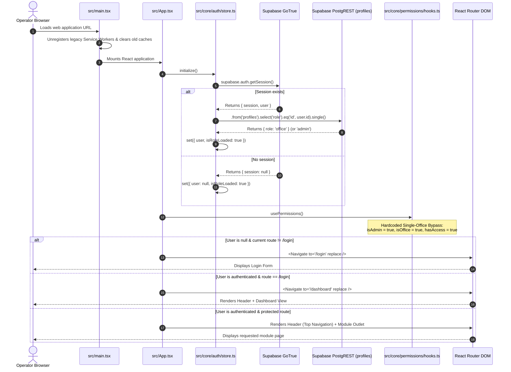
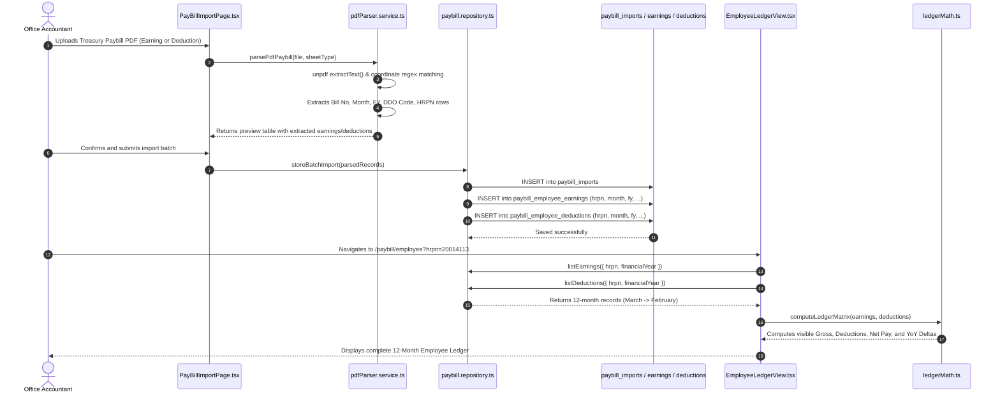
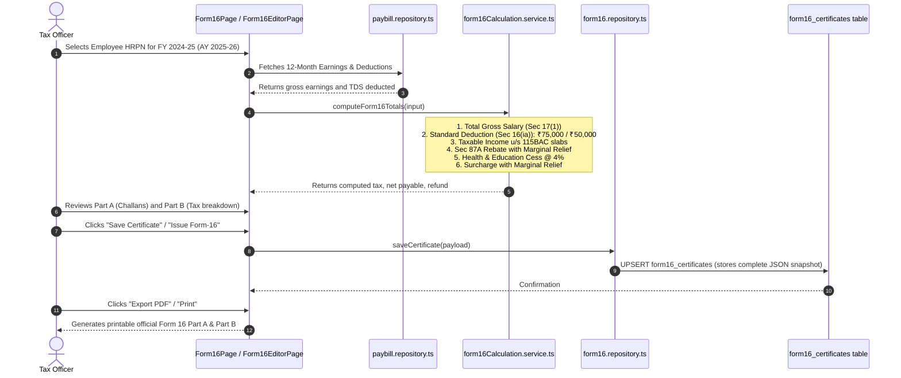
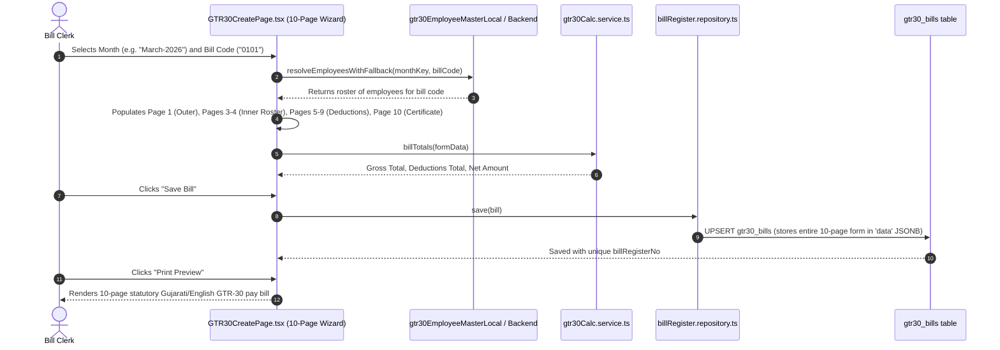
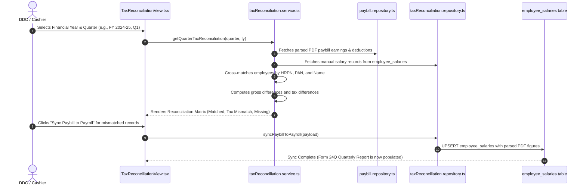
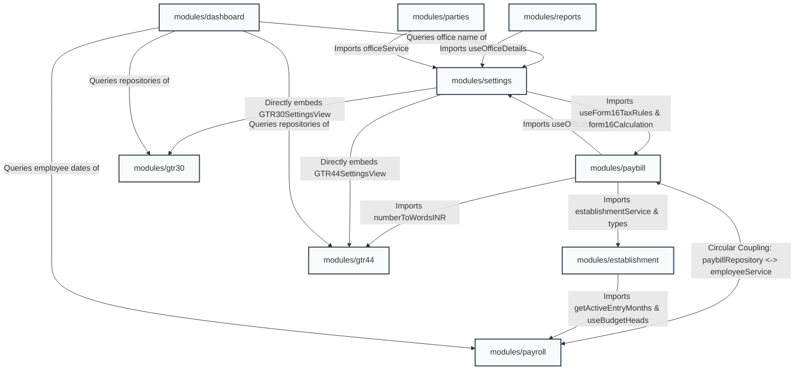

# ICDP Account Management System — System Design (As-Is Architecture Audit)

**Date of Audit:** October 9, 2026  
**Auditor:** Antigravity Discovery Audit Engine  
**Target Repository:** `E:\account-icdp\icdp-modern`  
**Classification:** Evidence-Based Read-Only Architectural Audit  
**Purpose:** Comprehensive baseline documentation of ICDP Modern (V1) to evaluate architectural health, technical debt, and viability of an ICDP V2 rebuild.

---

## 1. Executive Summary

The Intensive Cattle Development Programme (ICDP) Account Management System (`icdp-modern`) is a single-page web application (SPA) built for the ICDP Surat office under the Department of Agriculture, Farmers Welfare & Co-operation (Directorate of Animal Husbandry, Government of Gujarat).

The application manages financial, payroll, establishment, taxation, and treasury accounting workflows:
1. **Government Pay Bills (GTR-30):** 10-page statutory pay bill generation, scheduling, and billing registers.
2. **Detailed Contingent Bills (GTR-44):** 22-item contingent expenditure bills, sub-vouchers, and certifications.
3. **Employee Paybill Ledger & IT Computation:** Ingestion and parsing of monthly Treasury Computerized Paybill PDFs, generation of 12-month Employee Ledgers, Allowance Matrices, and Form-16 certificates u/s 115BAC.
4. **Salary TDS (Form 24Q) & Reconciliation:** Monthly salary records, quarterly return aggregations, budget head tracking, and automated reconciliation between parsed paybills and salary registers.
5. **Vendor TDS (Form 26Q) & GST:** Commercial party transaction register, 2% TDS on GST, commercial tax registers, and annual summaries.
6. **Establishment Register:** Cadre-wise sanctioned strength (મહેકમ માહિતી), post management, and canonical employee directory.
7. **Government Resolution (GR) Document Repository:** Archival, categorization, and retrieval of departmental government resolutions and circulars with a private Supabase Storage bucket (`gr-documents`) and short-lived signed URLs.

### Key Architectural Reality vs. Stated Design

While the project's documentation (`docs/architecture.md`) articulates an ideal vertical-slice architecture where business logic belongs strictly on the backend and modules operate independently, the actual code reveals significant architectural divergence:
- **Client-Side Heavy Business Logic:** Income tax calculations (Section 115BAC slabs, standard deduction, Section 87A rebate with marginal relief, surcharge), GTR-30 allowances, GTR-44 expenditure aggregations, and PDF paybill parsing run entirely inside browser JavaScript/TypeScript.
- **De-facto Single-Tenant Open Security Model:** An architectural shift occurred between migrations `042` and `045` (late August 2026) converting the application from a multi-office architecture to a single-office model. As a consequence, PostgreSQL Row-Level Security (RLS) on all public tables was flattened to `auth.uid() IS NOT NULL`, granting every authenticated user full CRUD permissions on all database records. Frontend authorization hooks (`usePermissions`) were hard-coded to return `isAdmin: true` and `hasAccess: true`.
- **Triplicated Data Models:** Employee master data exists across three separate tables (`employees`, `gtr30_employee_master`, `establishment_employees`), and salary records exist across three separate stores (`employee_salaries`, `employee_salary`, and `paybill_employee_earnings`/`deductions`). A dedicated Tax Reconciliation subsystem exists solely to sync data between the paybill PDF store and the payroll salary store.
- **Dual Storage (Local-First Synchronization Engine):** The GTR-30 and Establishment modules implement an in-memory/localStorage-first repository pattern with debounce queues, retry backoffs, and optimistic local caching that synchronizes asynchronously with Supabase PostgreSQL via RPCs and direct REST calls.
- **Document Store in PostgreSQL:** Core entities such as GTR-30 bills, GTR-44 bills, budget head mappings, and Form-16 certificates store complete documents inside large PostgreSQL `JSONB` columns rather than normalized relational structures.

---

## 2. Actual Technology Stack

| Domain | Technology / Library | Version (from package.json) | Purpose & Usage Evidence |
|---|---|---|---|
| **Runtime & Language** | TypeScript | `^5.9.2` | Full codebase typed. Zero compilation errors confirmed via `tsc --noEmit`. |
| **Frontend Framework** | React | `^18.3.1` | Concurrent mode enabled; strict mode active in [src/main.tsx](file:///e:/account-icdp/icdp-modern/src/main.tsx#L28). |
| **DOM Renderer** | React DOM | `^18.3.1` | Client root hydration at `#root`. |
| **Build Tool & Bundler** | Vite | `^5.4.19` | ES module dev server, Rollup production bundler, custom path alias `@ -> src`. |
| **Routing** | React Router DOM | `^6.30.1` | Declarative client-side routing, nested routes, lazy loading via dynamic `import()`. |
| **Server State Management** | TanStack Query (`@tanstack/react-query`) | `^5.85.5` | Global cache, query invalidation, background refetching configured in [src/core/query-client.ts](file:///e:/account-icdp/icdp-modern/src/core/query-client.ts). |
| **Client UI State** | Zustand | `^5.0.8` | Lightweight stores with `persist` middleware for Auth ([src/core/auth/store.ts](file:///e:/account-icdp/icdp-modern/src/core/auth/store.ts)), UI/Theme/FY ([src/core/stores/ui-store.ts](file:///e:/account-icdp/icdp-modern/src/core/stores/ui-store.ts)), and Feature Flags ([src/core/feature-flags/store.ts](file:///e:/account-icdp/icdp-modern/src/core/feature-flags/store.ts)). |
| **CSS & Design System** | Tailwind CSS + Autoprefixer | `^3.4.18` / `^10.4.21` | Utility-first styling with comprehensive custom design tokens in [tailwind.config.ts](file:///e:/account-icdp/icdp-modern/tailwind.config.ts). |
| **Class Utilities** | `clsx` + `tailwind-merge` | `^2.1.1` / `^3.6.0` | Merged through helper [src/utils/cn.ts](file:///e:/account-icdp/icdp-modern/src/utils/cn.ts). |
| **UI Primitives** | Radix UI (`@radix-ui/react-*`) | `^1.1.23` (dialog, slot, tabs, toast) | Unstyled, accessible UI foundation wrapped in [src/components/ui](file:///e:/account-icdp/icdp-modern/src/components/ui). |
| **Icons** | Lucide React (`lucide-react`) | `^1.30.0` | Comprehensive icon set mapped in [src/shared/icons.ts](file:///e:/account-icdp/icdp-modern/src/shared/icons.ts). |
| **Form Handling** | React Hook Form | `^7.62.0` | Uncontrolled form inputs with schema resolvers. |
| **Schema Validation** | Zod | `^3.25.76` | Runtime contract validation for forms, database rows, and RPC responses. |
| **Form Resolvers** | `@hookform/resolvers` | `^5.7.1` | Zod bridging into React Hook Form. |
| **Database & Auth Client** | Supabase JS (`@supabase/supabase-js`) | `^2.49.10` | PostgREST API client, GoTrue authentication client, Supabase Realtime client. |
| **Excel Export** | ExcelJS (`exceljs`) | `^4.4.0` | Rich styling, colored headers, formulas, cell borders for Employee Ledgers and Allowance Matrices. |
| **Excel Parsing** | SheetJS (`xlsx`) | `^0.18.5` | Binary workbook ingestion for salary Excel imports in `payroll`. |
| **PDF Extraction** | unpdf (`unpdf`) | `^1.8.1` | In-browser PDF text and coordinate extraction wrapping PDF.js in [src/modules/paybill/services/pdfParser.service.ts](file:///e:/account-icdp/icdp-modern/src/modules/paybill/services/pdfParser.service.ts). |
| **PDF Generation** | jsPDF (`jspdf`) + `jspdf-autotable` | `^4.2.1` / `^5.0.8` | Programmatic vector PDF generation for Form-16, paybill summaries, and official GR document mockups. |
| **Canvas Capture** | `html2canvas` | `^1.4.1` | HTML-to-image capture for GTR-44 bill printable preview rendering. |
| **Archive Compression** | JSZip (`jszip`) + `file-saver` | `^3.10.1` / `^2.0.5` | Client-side ZIP bundle packaging for bulk Form-16 PDF downloads. |
| **Virtual Scrolling** | TanStack Virtual (`@tanstack/react-virtual`) | `^3.14.9` | High-performance virtualized employee directory list in Employee Ledger view. |
| **Charts** | Recharts (`recharts`) | `^3.10.1` | SVG charts for Dashboard overview (monthly salary trend, treasury donuts, vendor TDS). |
| **Testing Framework** | Vitest (`vitest`) | `^2.1.9` | Unit and integration test runner configured in [vitest.config.ts](file:///e:/account-icdp/icdp-modern/vitest.config.ts); 88 test files discovered. |
| **Component Testing** | React Testing Library + `jsdom` | `^16.3.0` / `^26.1.0` | DOM interaction testing for React components. |
| **Hosting & CDN** | Firebase Hosting | CLI driven | Static SPA hosting with single-page routing rewrites and immutable caching configured in [firebase.json](file:///e:/account-icdp/icdp-modern/firebase.json). |
| **Cloud Storage** | Supabase Storage | Supabase JS SDK | Private `gr-documents` bucket for GR PDFs; downloads use short-lived signed URLs. |
| **Local Helper Service** | Python Flask + PaddleOCR | Standalone | [scripts/ocr_server.py](file:///e:/account-icdp/icdp-modern/scripts/ocr_server.py) provides local optical character recognition for scanned Gujarati and English documents. |

---

## 3. High-Level Architecture Diagram

```mermaid
flowchart TD
    subgraph Client["Client Browser (React 18 SPA)"]
        direction TB
        Main["main.tsx (Root Hydration)"]
        App["App.tsx (Routing & Shell)"]
        AuthGate["AuthGate (Session Enforcer)"]
        Header["Header (3-Level Flyout Navigation)"]
        Routes["Routes (Lazy Module Views)"]

        subgraph ClientStores["Client State & Storage"]
            AuthStore["useAuthStore (Zustand + Auth Listener)"]
            UIStore["useUIStore (Theme + Active FY)"]
            FlagsStore["useFeatureFlags (Module Flags)"]
            QueryCache["TanStack Query Cache (5 min staleTime)"]
            LocalStorage["Browser localStorage (GTR-30 & Establishment Local Repos)"]
        end

        subgraph Modules["Discovered Feature Modules (11)"]
            M_Auth["Auth"]
            M_Dash["Dashboard"]
            M_GTR30["GTR-30 Pay Bills"]
            M_GTR44["GTR-44 DC Bills"]
            M_Paybill["Paybill (Employee IT & Form 16)"]
            M_Payroll["Payroll (Salary TDS 24Q)"]
            M_Parties["Parties (Vendor TDS 26Q)"]
            M_Reports["Reports & Annual Returns"]
            M_Est["Establishment (Posts & Staff)"]
            M_GR["GR Repository (Doc Archive)"]
            M_Settings["Master Settings"]
        end
    end

    subgraph BackendServices["Backend Infrastructure"]
        subgraph Supabase["Supabase Cloud Platform"]
            S_Auth["GoTrue Auth Service (email/password)"]
            S_PostgREST["PostgREST API Server"]
            S_Storage["Supabase Storage (private gr-documents bucket)"]
            subgraph Postgres["PostgreSQL Database"]
                Tables["39 Public Base Tables"]
                RPCs["27 PL/pgSQL RPC Functions"]
                RLS["Row-Level Security (auth.uid() IS NOT NULL)"]
            end
        end

        subgraph External["External Cloud & Auxiliary Services"]
            Firebase["Firebase Hosting (Static CDN)"]
            OCRServer["Local Python Flask OCR Server (Port 5005)"]
        end
    end

    Main --> App
    App --> AuthGate
    AuthGate --> AuthStore
    App --> Header
    App --> Routes
    Routes --> Modules

    Modules --> QueryCache
    Modules --> LocalStorage

    AuthStore <-->|Session / JWT| S_Auth
    QueryCache <-->|REST CRUD Queries| S_PostgREST
    QueryCache <-->|RPC Function Invocations| RPCs
    S_PostgREST --> Tables
    RPCs --> Tables

    M_GR -->|Upload PDF / create signed URL| S_Storage
    M_Paybill -.->|Manual Text Paste| OCRServer
    Firebase -.->|Hosts Static Assets| Client
```



---

## 4. Discovered Module Inventory

The application dynamically registers modules via `import.meta.glob('./**/module.ts', { eager: true })` in [src/modules/index.ts](file:///e:/account-icdp/icdp-modern/src/modules/index.ts). Exactly 11 modules exist:

| Module Identifier | Display Name | Navigation Group | Sidebar Order | Primary Routes | Storage Backing | Current Architectural Status |
|---|---|---|---|---|---|---|
| `auth` | Authentication | `main` (hidden) | N/A | `/login`, `/forgot-password`, `/update-password` | Supabase Auth, `profiles` | **Active / Stable** |
| `dashboard` | Dashboard Overview | `overview` | 1 | `/dashboard` | `employees`, `employee_salaries`, `gtr30_bills`, `gtr44_bills`, `parties`, `party_transactions` | **Active / Functional** |
| `gtr44` | GTR-44 DC Bills | `bills` | 1 | `/gtr44/create`, `/gtr44/list`, `/gtr44/view/:id`, `/gtr44/edit/:id` | `gtr44_bills`, `app_config` | **Active / Functional** |
| `gtr30` | GTR-30 Pay Bills | `bills` | 2 | `/gtr30/create`, `/gtr30/list`, `/gtr30/view/:id`, `/gtr30/edit/:id`, `/gtr30/employee-management` | `gtr30_bills`, `gtr30_employee_master`, `gtr30_budget_heads`, `gtr30_bill_code_mappings`, `localStorage` | **Active / Heavy Dual Storage** |
| `payroll` | Salary TDS (24Q) | `tds` | 1 | `/payroll/entry`, `/payroll/report`, `/payroll/reconciliation`, `/payroll/budget`, `/payroll/lookup`, `/payroll/employees` | `employees`, `employee_salaries`, `salary_imports`, `employee_salary`, `budget_heads` | **Active / Legacy Overlap** |
| `parties` | Vendor TDS (26Q) | `tds` | 2 | `/parties/overview`, `/parties/gst`, `/parties/it` | `parties`, `party_transactions`, `office_details` | **Active / Functional** |
| `reports` | TDS Reports & Returns | `tds` | 3 | `/reports/24q`, `/reports/26q`, `/reports/gst` | `employees`, `employee_salaries`, `parties`, `party_transactions` | **Active / Client-Side Reporting** |
| `it-employee` (`paybill`) | Employee IT | `it-employee` | 1 | `/paybill/matrix`, `/paybill/employee`, `/paybill/form16`, `/paybill/form16/:hrpn`, `/paybill/history`, `/paybill/components`, `/paybill/legacy-edit` | `paybill_imports`, `paybill_employee_earnings`, `paybill_employee_deductions`, `paybill_vouchers`, `payroll_components`, `form16_certificates` | **Active / Core Financial Engine** |
| `establishment` | Establishment | `establishment` | 6 | `/establishment`, `/establishment/posts`, `/establishment/employees/new`, `/establishment/employees/edit/:id` | `establishment_employees`, `establishment_posts`, `establishment_pay_entries`, `localStorage` | **Active / Dual Storage** |
| `gr_repository` | GR Repository | `tools` | 6 | `/gr-repository`, `/gr-repository/*` | `gr_repository`, `gr_departments`, `gr_categories`, `gr_subcategories`, `gr_document_relations`, `gr_audit_logs`, Supabase Storage (`gr-documents`) | **Active / Functional** |
| `settings` | Master Settings | `system` | 9 | `/settings/office`, `/settings/gtr30`, `/settings/gtr44`, `/settings/tax-rules`, `/settings/form16` | `office_details`, `offices`, `app_config`, `paybill_settings` | **Active / Composite Hub** |

---

## 5. Startup and Authentication Flow



### Detailed Lifecycle Phases

1. **Root Bootstrapping (`src/main.tsx`):**
   - Strips `'dark'` class from HTML document root (light theme enforcement by default).
   - Registers error listeners on `window.addEventListener('vite:preloadError')` and `unhandledrejection` to trigger `reloadForChunkUpdate()` if a user encounters a stale chunk hash after deployment.
   - Cleans up legacy service workers and deletes cached storage keys starting with `icdp-cache-`.
   - Mounts `QueryClientProvider` and `BrowserRouter`.
2. **App Shell Initialization (`src/App.tsx`):**
   - Calls `useAuthStore().initialize()` on mount.
   - Subscribes to Supabase `onAuthStateChange`.
   - Resolves standalone screens (e.g. `/paybill/form16/:hrpn`, `/paybill/legacy-edit`, `/gtr30/employee-management/edit/:id`, or `?popup=true`) which render full-height without the primary top navigation header.
   - Resolves standard screens which render inside `<Layout>` with the `<Header modules={modules} />` flyout bar.
3. **Permission Resolution (`src/core/permissions/hooks.ts`):**
   - The original role-based access control (RBAC) queried `profiles.role` for `'admin'` vs `'office'`.
   - In the current single-office mode, `usePermissions` returns `{ isAdmin: true, isOffice: true }` unconditionally, bypassing all client authorization guards.

---

## 6. Database Architecture Overview

### Schema Statistics

- **Total Base Tables:** 39 public tables defined in [src/shared/database.types.ts](file:///e:/account-icdp/icdp-modern/src/shared/database.types.ts) and migration history.
- **Total Migrations:** 50 sequential SQL files spanning August 7, 2026 to October 8, 2026.
- **SQL Functions / RPCs:** 27 custom PostgreSQL functions declared in types; additional administrative helper functions dropped in migration `049`.
- **Row-Level Security:** RLS is enabled across all public tables, but universally open via `CREATE POLICY "allow_authenticated_all" ON public.%I FOR ALL USING (auth.uid() IS NOT NULL)` (Migration `044`).

### Core Schema Domains

```mermaid
erDiagram
    PROFILES ||--o{ OFFICES : "legacy reference"
    OFFICES ||--o{ OFFICE_DETAILS : "1:1 profile"
    OFFICES ||--o{ BUDGET_HEADS : "categorizes"

    %% Legacy Payroll Domain
    BUDGET_HEADS ||--o{ EMPLOYEES : "classifies"
    EMPLOYEES ||--o{ EMPLOYEE_SALARIES : "has monthly salaries"
    SALARY_IMPORTS ||--o{ EMPLOYEE_SALARY : "contains imported rows"

    %% Parties Domain
    PARTIES ||--o{ PARTY_TRANSACTIONS : "receives payments"

    %% Modern Paybill Domain
    PAYBILL_IMPORTS ||--o{ PAYBILL_EMPLOYEE_EARNINGS : "contains earnings"
    PAYBILL_IMPORTS ||--o{ PAYBILL_EMPLOYEE_DEDUCTIONS : "contains deductions"
    PAYBILL_IMPORTS ||--o{ PAYBILL_EMPLOYEE_COMPONENTS : "contains breakdown"
    PAYBILL_IMPORTS ||--o{ PAYBILL_IMPORT_AUDITS : "tracked by"
    PAYROLL_COMPONENTS ||--o{ PAYROLL_COMPONENT_ALIASES : "mapped to text"
    PAYROLL_COMPONENTS ||--o{ PAYBILL_EMPLOYEE_COMPONENTS : "classifies"

    %% Form 16 Domain
    FORM16_CERTIFICATES ||--o{ FORM16_AUDIT_LOG : "tracked by"

    %% GTR-30 Domain
    GTR30_BILLS ||--|| GTR30_BUDGET_HEADS : "configured by"
    GTR30_BILLS ||--o{ GTR30_BILL_CODE_MAPPINGS : "associates"

    %% Establishment Domain
    ESTABLISHMENT_POSTS ||--o{ ESTABLISHMENT_EMPLOYEES : "designation reference"
    ESTABLISHMENT_EMPLOYEES ||--o{ ESTABLISHMENT_PAY_ENTRIES : "salary increments"

    %% GR Repository Domain
    GR_DEPARTMENTS ||--o{ GR_REPOSITORY : "issued by"
    GR_CATEGORIES ||--o{ GR_SUBCATEGORIES : "has subcategories"
    GR_CATEGORIES ||--o{ GR_REPOSITORY : "classified in"
    DOCUMENT_TYPES ||--o{ GR_REPOSITORY : "typed as"
    GR_REPOSITORY ||--o{ GR_DOCUMENT_RELATIONS : "linked with"
    GR_REPOSITORY ||--o{ GR_AUDIT_LOGS : "audit trail"
```



---

## 7. Major Financial Workflows

### Workflow 1: Paybill PDF Ingestion & Employee Ledger Generation



### Workflow 2: Form-16 Certificate Generation & Tax u/s 115BAC



### Workflow 3: GTR-30 Pay Bill Generation



### Workflow 4: Salary TDS (24Q) & Paybill Reconciliation



---

## 8. Deployment and Hosting Architecture

### Production Build & Delivery

- **Hosting Provider:** Firebase Hosting (`icdp-modern` project registered in `.firebaserc`).
- **Build Output Directory:** `dist/`.
- **SPA Routing:** Configured in `firebase.json` via URL rewrite:
  ```json
  "rewrites": [{ "source": "**", "destination": "/index.html" }]
  ```
- **HTTP Caching Policies:**
  - `**/*.@(js|css)`: `public, max-age=31536000, immutable` (hashed asset caching).
  - `index.html` & root `/`: `no-cache, no-store, must-revalidate` (guarantees instantaneous updates).
  - `/sw.js`: `no-cache, no-store, must-revalidate`.
- **Vite Chunking Strategy (`vite.config.ts`):**
  - Vendor shell separated into:
    - `react-vendor`: `react`, `react-dom`, `react-router-dom`, `zustand`, `@tanstack/react-query`.
    - `supabase`: `@supabase/supabase-js`.
  - Heavy specialized libraries (`pdfjs`, `jspdf`, `exceljs`, `xlsx`, `unpdf`, `jszip`, `html2canvas`, `recharts`) are left unbundled from the entry point, relying on dynamic `import()` and `React.lazy` within individual routes.

### Bundle Measurement Evidence (Verified from `dist/`)

| Asset Chunk Name | File Size on Disk | Primary Included Libraries |
|---|---|---|
| `pdfjs-*.js` | **1,672 KB** (1.67 MB) | PDF.js parsing engine (unpdf) |
| `xlsx-*.js` | **429 KB** | SheetJS binary workbook parser |
| `jspdf.es.min-*.js` | **390 KB** | jsPDF vector document creator |
| `PayBillImportPage-*.js` | **339 KB** | Paybill parsing, queues, modals |
| `supabase-*.js` | **220 KB** | Supabase JS client & GoTrue |
| `react-vendor-*.js` | **208 KB** | React core, Router, TanStack Query |
| `html2canvas.esm-*.js` | **202 KB** | DOM screenshot canvas renderer |
| `index-*.css` | **198 KB** | Compiled Tailwind styles & fonts |
| `SettingsPage-*.js` | **156 KB** | Unified settings screens & subforms |
| `index-*.js` (entry) | **147 KB** | Application core runtime & routing |
| `GRListPage-*.js` | **134 KB** | GR search, PDF viewers, modals |
| `GTR30Document-*.js` | **123 KB** | 10-page statutory printable layouts |

---

## 9. Major Cross-Module Dependencies

Although designed conceptually as isolated vertical slices, deep cross-module coupling exists:



### High-Risk Coupling Bottlenecks

1. **Circular Dependency between `paybill` and `payroll`:**
   - [src/modules/payroll/repositories/taxReconciliation.repository.ts](file:///e:/account-icdp/icdp-modern/src/modules/payroll/repositories/taxReconciliation.repository.ts#L2) imports `paybillRepository` from `@/modules/paybill`.
   - [src/modules/paybill/hooks/useEmployeeDirectory.ts](file:///e:/account-icdp/icdp-modern/src/modules/paybill/hooks/useEmployeeDirectory.ts#L4) imports `employeeService` from `@/modules/payroll`.
2. **Settings as an Omnipresent Dependency Sink:**
   - Rather than remaining an independent configuration slice, `settings` directly renders full presentation components from `gtr30` (`GTR30SettingsView`) and `gtr44` (`GTR44SettingsView`), and imports business calculation functions directly from `paybill` (`form16Calculation.service.ts`).
3. **Establishment as a Secondary Employee Dependency:**
   - `paybill` components ([PayBillLegacyDataEditor.tsx](file:///e:/account-icdp/icdp-modern/src/modules/paybill/components/PayBillLegacyDataEditor.tsx#L6), [Form16EditorPage.tsx](file:///e:/account-icdp/icdp-modern/src/modules/paybill/pages/Form16EditorPage.tsx#L36), [paybillReport.service.ts](file:///e:/account-icdp/icdp-modern/src/modules/paybill/services/paybillReport.service.ts#L36)) directly query `establishmentService` for employee names and active months, creating a multi-layered dependency on employee identity.

---

## 10. Evidence-Backed Architectural Weaknesses

1. **Compromised Database Security Model (Universal RLS Policy):**
   - Migration `044_master_single_office_unlock.sql` executed `CREATE POLICY "allow_authenticated_all" ON public.%I FOR ALL USING (auth.uid() IS NOT NULL) WITH CHECK (auth.uid() IS NOT NULL);` across all public tables.
   - Any client possessing a valid user session can run arbitrary `INSERT`, `UPDATE`, or `DELETE` statements on critical payroll, tax, and configuration records via PostgREST.
2. **Fragile Dual-Storage Architecture (Local vs. Backend):**
   - [src/modules/gtr30/services/gtr30EmployeeMaster.service.ts](file:///e:/account-icdp/icdp-modern/src/modules/gtr30/services/gtr30EmployeeMaster.service.ts) and [src/modules/establishment/services/establishment.service.ts](file:///e:/account-icdp/icdp-modern/src/modules/establishment/services/establishment.service.ts) maintain independent state in browser `localStorage`.
   - Mutations write immediately to `localStorage` and trigger debounced, un-monitored asynchronous backend syncs. If local storage is cleared or accessed across multiple browser tabs/devices, silent data divergence occurs.
3. **Non-Transactional Fallback Mutations:**
   - In [src/modules/gtr30/repositories/gtr30EmployeeMasterBackend.repository.ts](file:///e:/account-icdp/icdp-modern/src/modules/gtr30/repositories/gtr30EmployeeMasterBackend.repository.ts#L148-L180), if the RPC fails, the repository issues an unconditional `DELETE` query for the entire month/bill code group, followed by a sequential `for...of` loop executing individual row `INSERT` statements. A network interruption mid-loop results in permanent data loss.
4. **Data Triplication for Core Entities:**
   - Staff identities are maintained independently in `employees`, `gtr30_employee_master`, and `establishment_employees`.
   - Salary records exist concurrently in `employee_salaries` (manual entry), `employee_salary` (Excel upload), and `paybill_employee_earnings`/`deductions` (PDF parsing).
5. **Over-Reliance on JSONB Blobs for Relational Data:**
   - Entire 10-page GTR-30 bills are serialized into a single `data` JSONB column in `gtr30_bills`.
   - Entire GTR-44 contingent expenditure bills are serialized into `form_data` JSONB in `gtr44_bills`.
   - Form-16 certificates serialize taxpayer details, employer details, and Part A/Part B into multiple JSONB blobs.
   - This prevents PostgreSQL from enforcing integrity constraints, indexing item-level costs, or performing efficient relational analytics.
6. **Client-Side Financial Calculations:**
   - Critical Indian Income Tax rules (Section 115BAC slabs, standard deductions, 87A rebate ceilings, cess, and surcharge) execute on the client in [src/modules/paybill/services/form16Calculation.service.ts](file:///e:/account-icdp/icdp-modern/src/modules/paybill/services/form16Calculation.service.ts), violating architectural principle 1.
7. **Monolithic UI Components:**
   - Several UI components exceed 1,200 LOC: [Form16EditorPage.tsx](file:///e:/account-icdp/icdp-modern/src/modules/paybill/pages/Form16EditorPage.tsx) (1,534 LOC), [GTR30CreatePage.tsx](file:///e:/account-icdp/icdp-modern/src/modules/gtr30/pages/GTR30CreatePage.tsx) (1,531 LOC), [PayBillLegacyDataEditor.tsx](file:///e:/account-icdp/icdp-modern/src/modules/paybill/components/PayBillLegacyDataEditor.tsx) (1,406 LOC), and [GTR30EmployeeMasterForm.tsx](file:///e:/account-icdp/icdp-modern/src/modules/gtr30/components/GTR30EmployeeMasterForm.tsx) (1,225 LOC).

---

## 11. Unresolved Questions & Discovery Limitations

1. **Live Database Drift vs. Migrations:**
   - The repository contains migrations `040` through `050` as uncommitted working files. Without an authorized administrative direct connection to inspect the live PostgreSQL `pg_catalog`, it cannot be verified whether migrations `040`–`050` have been executed on the production Supabase instance or exist only on the local machine.
2. **GR Document Storage:**
   - GR PDFs are stored in the private Supabase Storage bucket `gr-documents` (migration `071_gr_supabase_storage.sql`) and served through short-lived signed URLs. The legacy Cloudflare R2 bucket has been emptied and R2 is fully decommissioned; no R2 configuration or tooling remains in the codebase.
3. **Orphaned Python OCR Service:**
   - `scripts/ocr_server.py` is present, but the frontend currently only exposes a manual text paste dialog (`OcrFallbackModal.tsx`). It is unverified whether operators actively run `ocr_server.py` in production or if it is an abandoned prototype.
